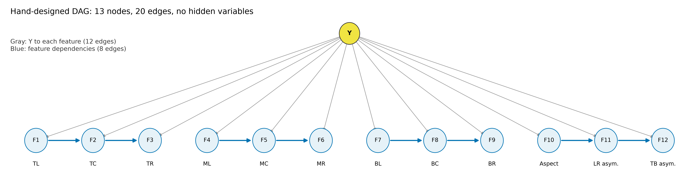
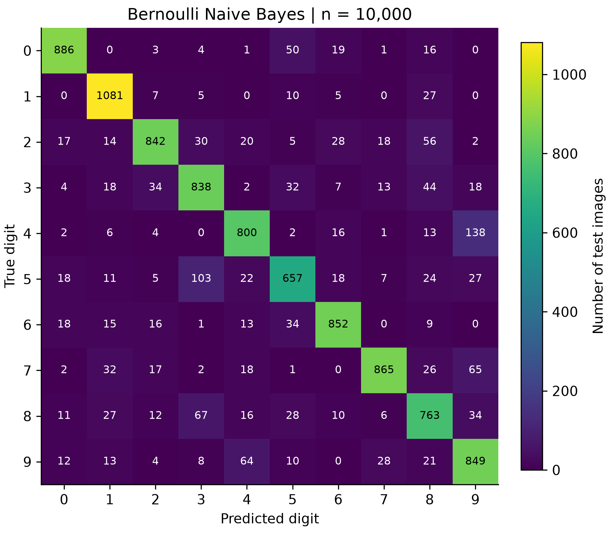
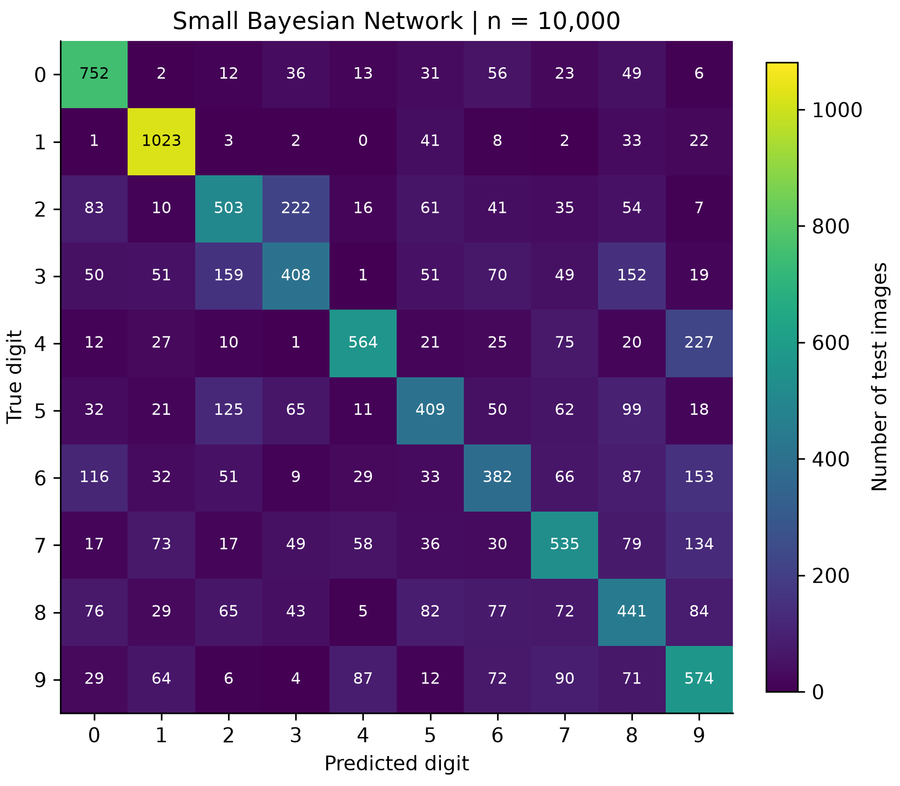
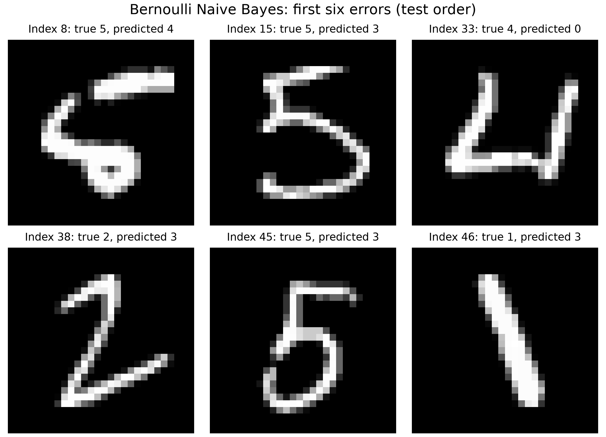
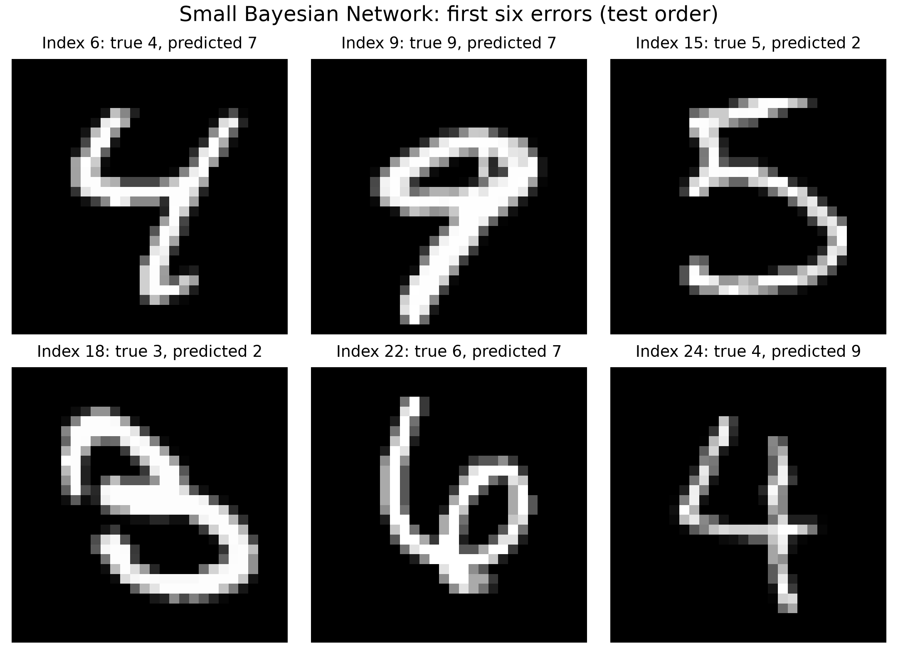

# 手写数字识别：朴素贝叶斯与小型贝叶斯网络

本报告为默认配置的实验报告初稿。实验于 2026 年 10 月 19 日运行，使用课程提供的完整 MNIST 训练集与测试集。Bernoulli Naive Bayes 的测试准确率为 **84.33%**，小型手工贝叶斯网络为 **55.91%**。本次比较用于检查概率建模、平滑、条件依赖与特征表达的差别。

## 1. 总体设计与数据

### 1.1 数据读取和检查

原始数据来自课程提供的 `assignment2-data.zip`，由其中的 `mnist_loader.py` 读取。该读取器逐字节保留在本目录中。运行前，`main.py` 将四个 gzip 文件的 SHA-256 与课程 `manifest.json` 中的固定值比对。本次四项校验全部通过。

| 项目 | 训练集 | 测试集 |
|---|---:|---:|
| 图像数 | 60,000 | 10,000 |
| 原始图像形状 | `(60000, 28, 28)` | `(10000, 28, 28)` |
| 模型输入形状 | `(60000, 784)` | `(10000, 784)` |
| 类别 | 0 至 9 | 0 至 9 |

原始图像为 `uint8`，像素范围为 0 至 255。训练图像没有缺失像素。测试集各类样本数依次为 980、1135、1032、1010、982、892、958、1028、974、1009，因此除 Accuracy 外同时报告宏平均指标。

两个模型都从原始 784 维像素输入出发，预处理在模型内部完成。所有训练统计仅使用训练数据。测试标签只用于评估、混淆分析和选取错误样例，没有参与拟合、分箱或结构设计。

### 1.2 两条建模路径

- Naive Bayes 将每个像素按 `pixel > 128` 转为二值变量，共使用 784 个变量，分别建模前景和背景的概率。
- Bayesian Network 将灰度图压缩为 9 个区域密度、1 个包围框宽高比、2 个镜像不对称度，共 12 个离散特征，再使用固定的手工 DAG 建模。

两个模型均使用 `alpha=1.0`。朴素贝叶斯的阈值、网络特征阈值和所有边均在本次测试前固定。本次没有进行超参数搜索，也没有使用自动结构学习。计算不涉及随机抽样或随机初始化。

## 2. Naive Bayes 算法

### 2.1 分类公式与条件独立

令 $B_i=\mathbf{1}[x_i>128]$。由贝叶斯公式，给定输入时后验分母对所有候选类别相同，因此分类可以比较先验与似然的乘积。

$$
\hat y=\arg\max_{c\in\{0,\ldots,9\}}P(Y=c)\prod_{i=1}^{784}P(B_i\mid Y=c).
$$

这里假设给定数字类别后，784 个像素条件独立。实际笔画相邻像素存在依赖，这一假设是模型近似。

### 2.2 参数估计和平滑

记训练样本总数为 $N$，类别 $c$ 的样本数为 $N_c$，其中第 $i$ 个像素为前景的样本数为 $S_{ci}$。采用加性平滑。

$$
\pi_c=\frac{N_c+\alpha}{N+10\alpha},\qquad
\theta_{ci}=\frac{S_{ci}+\alpha}{N_c+2\alpha}.
$$

每个像素的前景、背景分别获得 $\alpha$ 个伪计数。这样即使某类某个位置从未出现前景或背景，对应概率也不会为零。类别根分布同样进行平滑，并始终保留全部十类。

### 2.3 对数计算

$$
s_c=\log\pi_c+\sum_{i=1}^{784}\left[B_i\log\theta_{ci}+(1-B_i)\log(1-\theta_{ci})\right].
$$

预测返回最大分数的类别。代码将该式改写为矩阵乘法和类别偏置，仍包含全部背景证据。前景与背景的对数概率分别由平滑计数计算，避免极小平滑系数下先计算 `1-p` 带来的精度损失。

可选的 `predict_proba` 在每行分数中先减去最大值，再取指数并归一化。这一步提高数值稳定性；分类本身直接比较对数分数。

## 3. 小型手工贝叶斯网络

### 3.1 特征与离散化

将原始图像除以 255 得到灰度墨迹强度 $I\in[0,1]^{28\times28}$。行、列均按边界 `[0, 9, 19, 28]` 划成三段。区域密度为该区域的灰度均值，使用各区域自己的像素数作分母。

下表坐标从零开始，区间包含两端。D、A、S 分别对应表后的三组固定分箱。

| 节点 | 语义与计算 | 分箱 | 类别边的含义 |
|---|---|---|---|
| F1 | 上左密度，行 0–8、列 0–8 | D | Y→F1，类别与上左墨迹分布关联 |
| F2 | 上中密度，行 0–8、列 9–18 | D | Y→F2，类别与上中墨迹分布关联 |
| F3 | 上右密度，行 0–8、列 19–27 | D | Y→F3，类别与上右墨迹分布关联 |
| F4 | 中左密度，行 9–18、列 0–8 | D | Y→F4，类别与中左墨迹分布关联 |
| F5 | 中央密度，行 9–18、列 9–18 | D | Y→F5，类别与中心笔画分布关联 |
| F6 | 中右密度，行 9–18、列 19–27 | D | Y→F6，类别与中右墨迹分布关联 |
| F7 | 下左密度，行 19–27、列 0–8 | D | Y→F7，类别与下左墨迹分布关联 |
| F8 | 下中密度，行 19–27、列 9–18 | D | Y→F8，类别与下中墨迹分布关联 |
| F9 | 下右密度，行 19–27、列 19–27 | D | Y→F9，类别与下右墨迹分布关联 |
| F10 | 前景最小包围框宽度 / 高度 | A | Y→F10，类别与字形宽窄关联 |
| F11 | 左右镜像不对称度 | S | Y→F11，类别与左右形状差异关联 |
| F12 | 上下镜像不对称度 | S | Y→F12，类别与上下形状差异关联 |

- D 的阈值为 `[0.02, 0.08, 0.20, 0.40]`。
- A 的阈值为 `[0.45, 0.60, 0.75, 0.90]`。
- S 的阈值为 `[0.25, 0.40, 0.55, 0.70]`。

三组分箱都输出整数状态 0、1、2、3、4。对四个递增阈值 $t_0,t_1,t_2,t_3$，五个区间依次为 $[0,t_0)$、$[t_0,t_1)$、$[t_1,t_2)$、$[t_2,t_3)$、$[t_3,+\infty)$；恰好等于阈值时进入较高状态。宽高比的上界可以超过 1，仍由最后一档容纳。

包围框使用原始像素 `>128` 的前景确定，宽和高均包含首尾像素。没有前景时，宽高比定义为 0。左右不对称度为

$$
A_{LR}=\frac{\sum_{r,c}|I_{r,c}-I_{r,27-c}|}{2\sum_{r,c}I_{r,c}},
$$

上下不对称度使用 $I_{27-r,c}$ 替代镜像项。两项取值均在 0 至 1 之间，0 表示完全对称；全零图像的两项均定义为 0。

区域密度保留笔画的粗略空间分布，宽高比补充字形比例，镜像差异补充整体形状。这些特征计算简单、语义明确，也会丢失笔画连通、孔洞位置和局部弯曲等信息。

### 3.2 DAG 与每条边的解释



图中共 13 个节点、20 条边。Y 为唯一类别根节点，其到 12 个特征的边已在特征表逐项解释。额外 8 条特征边如下。

| 特征边 | 设计依据 |
|---|---|
| F1→F2 | 同一上部笔画可能跨越上左和上中区域 |
| F2→F3 | 上中与上右的墨迹量可能随上部横笔或弧线共同变化 |
| F4→F5 | 中左笔画可能延伸至中央区域 |
| F5→F6 | 中央与中右的笔画分布可能共同反映横笔或转折 |
| F7→F8 | 下左笔画或底部弧线可能延伸至下中区域 |
| F8→F9 | 下中与下右可能共同反映底部横笔或收笔方向 |
| F10→F11 | 字形宽窄可能影响左右镜像的重叠程度 |
| F11→F12 | 两个方向的整体不对称程度可能共同反映倾斜或字形组织 |

这些边是手工提出的统计依赖假设，方向由固定的建模分解决定，不表示物理因果关系，也未通过自动结构学习获得。每个特征以 Y 为父节点，另外最多包含表中的一个特征父节点，所以父节点总数最多为 2，包含 Y 在内。全部特征边均从较小编号指向较大编号，图中没有环或隐藏变量。

### 3.3 CPT 学习与推断

令 $Pa_i$ 为特征 $F_i$ 的完整父节点集合。对于某个父配置 $p$，统计训练样本数 $N_p$ 和其中子状态为 $v$ 的次数 $N_{p,v}$。

$$
P(F_i=v\mid Pa_i=p)=\frac{N_{p,v}+\alpha}{N_p+5\alpha}.
$$

每个父配置下的五个子状态分别平滑并归一化。若该父配置没有出现，五个状态均为 $1/5$。只有 Y 一个父节点的 CPT 形状为 `(10,5)`，有额外特征父节点时形状为 `(10,5,5)`；最后一维始终对应子状态。

Y 的先验采用与 NB 相同的平滑公式。预测时所有特征都已观测，对十个候选数字分别计算

$$
s_c=\log P(Y=c)+\sum_{i=1}^{12}\log P(F_i=f_i\mid Pa_i),\qquad \hat y=\arg\max_c s_c.
$$

父配置中涉及的 Y 均替换为当前候选类别，其余父变量取输入图像的已观测特征。无需采样或近似推理。

### 3.4 与 Naive Bayes 的关系

若删除全部特征间边，当前网络会退化为这 12 个离散特征上的朴素贝叶斯。保留额外边后，相应子特征的分布还依赖某个已观测特征。

本实验中的 NB 使用 784 个二值像素，BN 使用 12 个五值特征，两者的表示不同。因而二者的性能差异不能单独用来证明特征间边的效果。若要衡量这些边的贡献，应在同样的 12 个特征上比较有边和无边模型，并仅在训练集划出的验证集上决定设计。

## 4. 实验评估

### 4.1 环境与指标定义

实际运行环境为 Python 3.12.14、NumPy 2.3.5、Matplotlib 3.11.2。两个模型均使用完整 60,000 张训练图像训练，在全部 10,000 张测试图像上评估。配置、版本、数据校验值、源代码校验值和训练特征各状态频数均保存在 `results/run_metadata.json`。

混淆矩阵的行是真实类别，列是预测类别，顺序为 0 至 9。对每类计算 Precision、Recall 和 F1，再对十类取算术平均。Macro F1 直接平均逐类 F1，不使用 Macro Precision 和 Macro Recall 的调和平均。零分母时对应指标定义为 0。

### 4.2 总体结果

| 模型 | Accuracy | Macro Precision | Macro Recall | Macro F1 | 正确 / 错误 |
|---|---:|---:|---:|---:|---:|
| Bernoulli Naive Bayes | 0.843300 | 0.844144 | 0.840890 | 0.841613 | 8433 / 1567 |
| Small Bayesian Network | 0.559100 | 0.554195 | 0.553372 | 0.550208 | 5591 / 4409 |

NB 的准确率比 BN 高 28.42 个百分点。本次单次运行中，NB 的训练与预测耗时分别约为 0.119 秒、0.036 秒，BN 分别约为 1.546 秒、0.269 秒。BN 的耗时包含内部图像特征提取；此处没有重复计时，不能作为跨机器性能基准。

### 4.3 混淆矩阵与每类表现





两张图使用相同的计数色阶，格内直接标出样本数。完整矩阵另存于 `results/confusion_naive_bayes.csv` 与 `results/confusion_bayes_net.csv`。

| 数字 | 测试数 | NB Recall | BN Recall |
|---:|---:|---:|---:|
| 0 | 980 | 0.904082 | 0.767347 |
| 1 | 1135 | 0.952423 | 0.901322 |
| 2 | 1032 | 0.815891 | 0.487403 |
| 3 | 1010 | 0.829703 | 0.403960 |
| 4 | 982 | 0.814664 | 0.574338 |
| 5 | 892 | 0.736547 | 0.458520 |
| 6 | 958 | 0.889353 | 0.398747 |
| 7 | 1028 | 0.841440 | 0.520428 |
| 8 | 974 | 0.783368 | 0.452772 |
| 9 | 1009 | 0.841428 | 0.568880 |

两种模型对 1 的召回率都较高，这与其较窄且相对简单的字形相符。BN 对 6 和 3 的召回率不足 0.41，说明这些粗特征未能充分保留相应字形的辨识信息。

### 4.4 易混淆数字对

按两个方向的错误数之和排序，前五对如下。对于表中的 a、b，两个方向均为真实类别到预测类别。

| 模型 | 数字对 a、b | a→b | b→a | 合计 |
|---|---|---:|---:|---:|
| NB | 4、9 | 138 | 64 | 202 |
| NB | 3、5 | 32 | 103 | 135 |
| NB | 3、8 | 44 | 67 | 111 |
| NB | 7、9 | 65 | 28 | 93 |
| NB | 0、5 | 50 | 18 | 68 |
| BN | 2、3 | 222 | 159 | 381 |
| BN | 4、9 | 227 | 87 | 314 |
| BN | 6、9 | 153 | 72 | 225 |
| BN | 7、9 | 134 | 90 | 224 |
| BN | 3、8 | 152 | 43 | 195 |

4 与 9 在两模型中都容易混淆。它们可能具有相近的竖笔和中上部墨迹分布，孔洞开合、横笔位置等细节会影响判别。BN 的 2 与 3 混淆尤其明显；区域均值与镜像差异无法完整描述底部转折、弧线开口与笔画连接。这些是依据特征定义提出的解释，尚未由消融实验单独验证。

### 4.5 误分类样例

以下两图分别展示各模型按测试集原始顺序出现的前六个错误，共 12 张样例，超过作业要求的至少 3 张。索引从 0 开始，图中保留原始灰度图。选取规则固定，不代表全部错误的统计分布。



NB 图像中的索引 15 和 45 都是真实的 5，被预测为 3；两张图都存在明显的下部弧线。索引 8 的 5 上部横笔与主体分离，属于较不规则字形。索引 46 的 1 有明显倾斜，模型将它识别为 3。固定位置的二值像素特征难以适应这种位置、倾斜和书写形态变化，而条件独立假设也无法直接表示一段连续笔画的形状。



BN 的索引 6 将 4 识别为 7，索引 9 将 9 识别为 7，索引 24 将 4 识别为 9。索引 18 的 3 被识别为 2，索引 22 的 6 被识别为 7。即使人眼可见横笔或环形结构，12 个离散摘要也没有显式编码这些拓扑差异；不同图像可能被压缩成相同或接近的特征组合。这说明特征压缩会限制网络可以利用的信息。

以上为事后视觉分析，不能据此确定某个特征对某次错误的因果贡献。所有真实标签和预测标签均可在 `results/predictions.csv` 中按索引独立核对。

## 5. 讨论与反思

### 5.1 实现中需要解决的问题

原始概率连乘会下溢，因此两个模型统一使用对数分数。CPT 还必须按完整父配置统计并沿子状态归一化，不能把整类样本数直接用作每个 CPT 行的分母。稀疏或未出现的父配置通过平滑得到有效概率。两个评测文件须可独立加载，预处理也不能要求调用者先提供已提取特征。

本次为这些问题设置了 17 项检查，包括与显式 Bernoulli 公式及独立 CPT 计数的数值比较、未见类别与父配置的平滑、特征语义和边界、DAG 约束、接口签名与加载，以及指标的手算示例。图像还经过文字边界、刻度重叠检查与逐图视觉核对。这些检查提高实现可信度，但不替代对模型假设的分析。

### 5.2 模型局限

NB 将相关像素当作独立证据，可能重复累积同一笔画提供的信息。阈值二值化丢弃灰度差异，固定位置特征对平移和倾斜敏感，输出概率也没有经过校准评估。

小型 BN 放松了部分条件独立假设，但其输入信息量显著少于 NB。固定 3×3 网格、宽高比和镜像差异没有直接描述孔洞、连通性或局部方向。本次训练频数还显示，F1、F3、F7、F9 的最高密度档均没有样本；固定分箱在这些区域的利用并不均匀。这是后续应在训练/验证集上检查的设计问题。

额外父节点增加了 CPT 的条件配置数，可能使估计更稀疏。手工边的语义合理性也不保证提高分类性能。本次没有对分箱阈值或边做验证集比较，无法把较低准确率归因于某一条边。

### 5.3 后续改进

可以先在训练集内部划分验证集，比较几种预先提出的分箱方案、平滑系数和符合约束的手工 DAG。结构仍需由人设计，不采用自动结构学习。最终配置确定后，再重新使用完整训练集拟合并做最终测试。

在保持 6 至 12 个离散特征、每项 2 至 5 状态的限制内，可以考虑用孔洞数、上下半部笔画分布或方向特征替换信息量有限的区域密度。还可以在同一组特征上移除特征间边做消融比较，以区分特征表示与网络依赖的作用。

本节记录可由本版代码与结果核查的技术问题。作者可在理解、复现与复核后补充自己的学习经历和个人反思。

## 6. 复现与资料来源

在本目录安装依赖后运行以下命令。

```console
python -m pip install -r requirements.txt
python -m unittest discover -s tests -v
python main.py --data-dir ../assignment2-data/mnist
```

模型核心只依赖 NumPy，Matplotlib 用于图像生成。`main.py` 会生成逐样本预测、指标、混淆矩阵、图像和实验元数据；本报告是该默认配置结果的整理稿，不会被程序自动重写。

本次使用的资料与代码来源如下。

1. 课程讲义《手写数字识别：朴素贝叶斯与小型贝叶斯网络（Assignment - 2）》，发布于 2026 年 10 月 12 日。模型协议、任务约束与报告要求以此为准。
2. 课程 `assignment2-data.zip` 内的 `README.md` 和 `mnist/manifest.json`。数据按课程记录来自 [Google CVDF 的 MNIST 镜像](https://storage.googleapis.com/cvdf-datasets/mnist/)，本次直接使用课程附带文件。
3. 同一数据包内的 `mnist_loader.py`，在本目录中原样保留，用于 gzip/IDX 读取及数据形状检查。没有复制外部朴素贝叶斯或贝叶斯网络实现，也没有使用相应现成模型库。

制作记录：本基线代码和报告初稿由 Codex 辅助搭建，保留源码、检查与原始预测供作者及 Gemini 复核。
