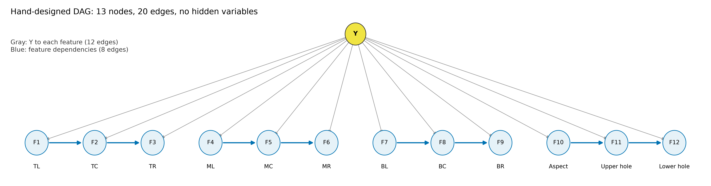
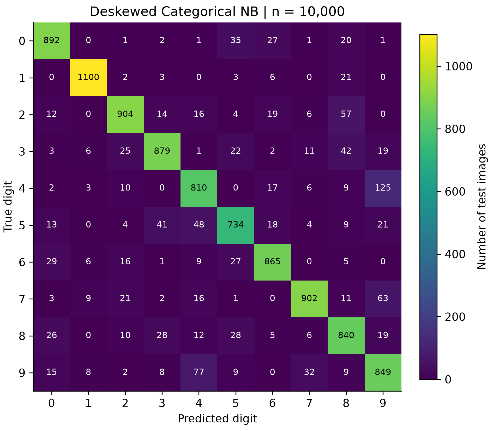
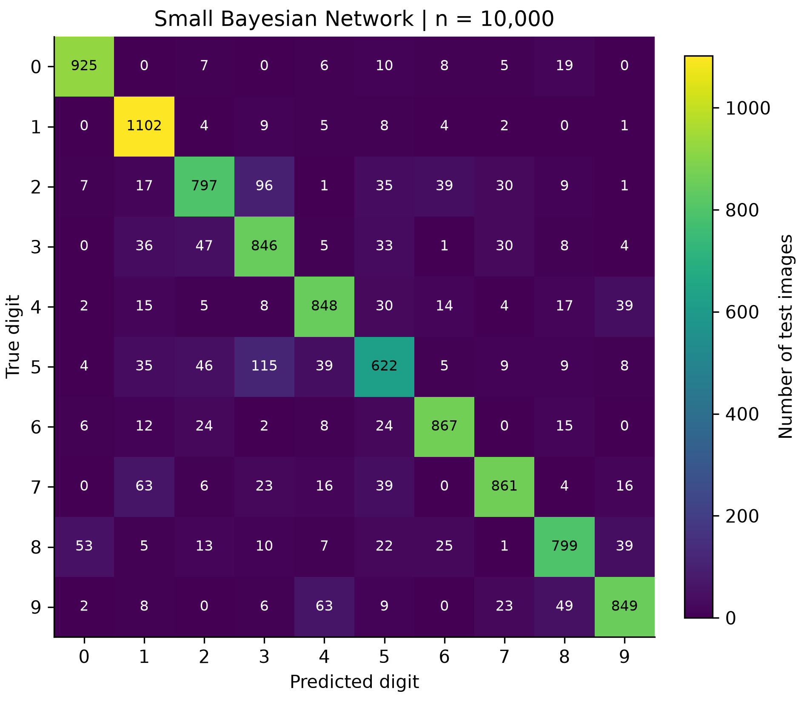
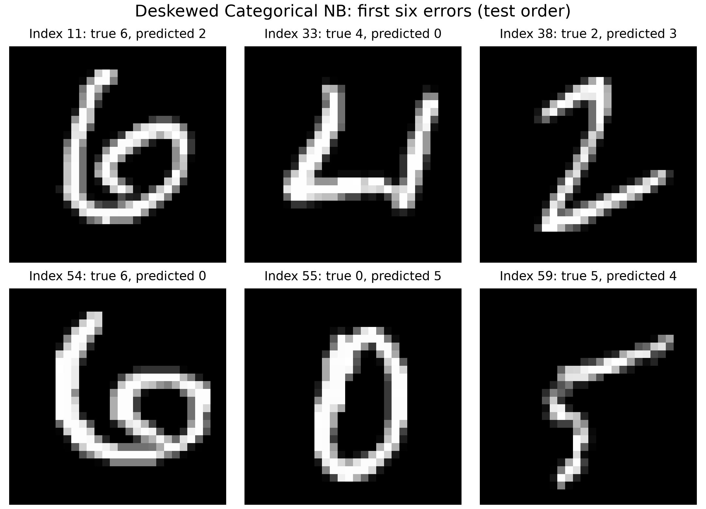
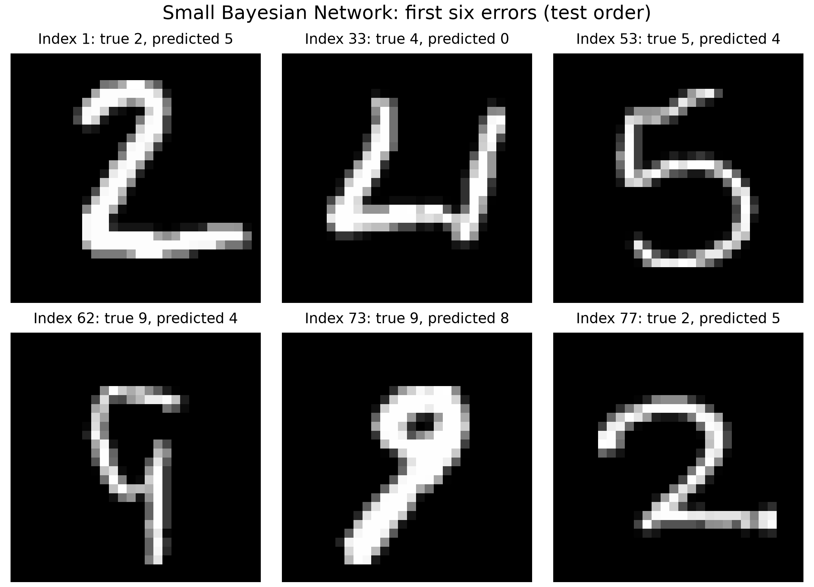

# 手写数字识别：朴素贝叶斯与小型贝叶斯网络（优化版）

本报告为优化版实验报告初稿。初版报告、原图、原代码与原始实验结果完整保存在 [history/initial/report.md](history/initial/report.md)，正文逐字节保留。本版在作业允许的模型与特征范围内改进预处理、特征表达和参数配置。

最终完整测试集准确率由初版的 NB 84.33%、BN 55.91% 提升至 **NB 87.75%、BN 85.16%**。提升分别为 3.42 和 29.25 个百分点。以下区分训练集内部验证结果与完整测试集结果。

## 1. 总体设计与实验边界

### 1.1 数据与读取

使用课程 `assignment2-data.zip` 中的标准 MNIST，训练集 60,000 张、测试集 10,000 张，图像均为 28×28 的 `uint8` 灰度图，像素范围为 0 至 255，标签为 0 至 9。课程读取器 `mnist_loader.py` 原样保留，四个 gzip 文件按课程清单进行 SHA-256 校验。

模型始终接收原始 `(n_samples,784)` 像素矩阵，所有预处理在类内部完成。两个模型的概率估计、平滑、计数和预测均使用自编 NumPy 代码，没有调用现成分类器或贝叶斯网络库。

### 1.2 训练集内部选型

本轮先固定候选方案与评判规则，保存在 `optimization_protocol.json`，再使用随机种子 `20261019`，从原始训练集每类抽出 1,000 张作为验证集。由此得到 50,000 张用于候选模型训练，10,000 张用于验证。具体索引保存在 `results/optimization/validation_indices.csv`。

NB 比较有无去倾斜、四种二值阈值、4/8 档灰度及三个平滑系数，共 36 组。BN 比较六种特征/分箱组合与三个平滑系数，共 18 组。候选总数为 54，统一以验证集 Macro F1 最大为首要标准，再比较 Accuracy。

BN 的 DAG 连接方式在候选实验开始前手工固定，全部候选使用同一组父节点编号，没有自动搜索边、按数据排序边或学习网络结构。训练分位数仅作为候选分箱策略，统计量只来自 50,000 张训练子集；最终选中的 BN 使用固定阈值。

`optimize.py` 仅读取训练图像与训练标签两个文件，不读取原始测试集。正式实现复现选中方案的验证指标后，模型源码与配置写入 `selected_config.json` 冻结，再使用全部 60,000 张训练图像重新估计概率参数，并评估完整测试集。

初版测试结果此前已经被查看，因此本次属于同一公开测试集上的后续开发比较，不能把它描述为完全未接触过的独立测试。本轮候选排序只依赖训练集内部验证结果，没有根据本轮最终测试结果继续调整模型。相同冻结配置复跑时指标一致。

### 1.3 接口和平滑配置

两个类的构造函数均保持课程规定的 `__init__(self, alpha: float = 1.0)`，并保留 `fit(self,X,y)`、`predict(self,X)`，`fit` 返回 `self`。`bayes_net.py` 仍提供独立的 `extract_features(X)`。

验证选中的平滑系数均为 **0.1**，因此 `main.py` 显式传入 `alpha=0.1`。报告中的最终指标对应这一配置。若助教或调用者省略参数，类会按协议使用 `alpha=1.0`，这与报告中显式选择的配置有区别。

## 2. Naive Bayes 模型

### 2.1 去倾斜与八档像素

首先对每张图像单独计算灰度质量中心 $(c_x,c_y)$ 及二阶中心矩。

$$
\mu_{11}=\sum_{x,y}I(x,y)(x-c_x)(y-c_y),\qquad
\mu_{02}=\sum_{x,y}I(x,y)(y-c_y)^2.
$$

令 $k=\mathrm{clip}(\mu_{11}/\mu_{02},-1,1)$。当质量或垂直方差为零时，令 $k=0$。对输出位置 $(x,y)$，在输入的 $x+k(y-c_y)$ 处做水平方向线性插值，图像范围外填 0，得到去倾斜图像。这是确定性的逐图几何预处理，不学习标签或分类规则。

去倾斜像素按 $Q_i=\lfloor x'_i/32\rfloor$ 分成 8 档，限制在 0 至 7。区间依次为 `[0,32)`、`[32,64)`，直到 `[224,256)`。使用灰度档保留部分笔画边缘强度信息。

作业对 NB 允许灰度离散化，没有将其限制为 2 至 5 档；本版 BN 的每个特征仍严格为 5 档。

### 2.2 概率估计、独立假设与对数预测

给定类别后近似认为 784 个离散像素变量条件独立。

$$
P(Y=c\mid Q)\propto P(Y=c)\prod_{i=1}^{784}P(Q_i\mid Y=c).
$$

记类别样本数为 $N_c$、总训练数为 $N$、第 $i$ 个像素状态为 $v$ 的类别内计数为 $N_{civ}$。对先验与每个状态进行加性平滑。

$$
\pi_c=\frac{N_c+\alpha}{N+10\alpha},\qquad
\theta_{civ}=\frac{N_{civ}+\alpha}{N_c+8\alpha}.
$$

每个位置八个状态的条件概率之和为 1，未出现的灰度状态也有正概率。预测采用

$$
s_c=\log\pi_c+\sum_{i=1}^{784}\log\theta_{ciQ_i},\qquad
\hat y=\arg\max_c s_c.
$$

所有像素均参与求和，包括灰度状态 0 的背景。对数计算避免概率连乘下溢。可选的 `predict_proba` 使用减去每行最大分数后的指数归一化。去倾斜并没有消除真实笔画之间的依赖，条件独立仍是模型近似。

## 3. 小型手工贝叶斯网络

### 3.1 预处理、归一化与孔洞定义

以 `pixel > 64` 作为前景，确定原始图像的最小前景包围框，其宽高比单独保留。将包围框内的灰度图以最近邻采样映射到 21×21。对归一化坐标 $r,c\in\{0,\ldots,20\}$，采样原图坐标为

$$
r_s=t+\lfloor rh/21\rfloor,\qquad c_s=l+\lfloor cw/21\rfloor,
$$

其中 $t,l,h,w$ 为原始包围框上边界、左边界、高度和宽度。没有前景时使用整幅画布进行灰度采样，并将宽高比定义为 0。九个区域是 21×21 图像上不重叠的 7×7 网格，密度为对应灰度均值除以 255。

孔洞在**原始 28×28 前景掩码**上计算。对背景从图像四边做四邻域洪泛填充，无法到达边界的背景像素定义为封闭背景。该过程由 NumPy 布尔运算自行实现。随后使用相同包围框映射采样孔洞掩码，分别统计归一化图像上 10 行、下 11 行中的孔洞面积比例。

这种定义能区分封闭孔洞和开放弧线。它依赖前景阈值与背景连通规则，细小断裂可能使一个孔洞消失；这些属于特征设计局限。

### 3.2 十二个特征和离散化

下表坐标位于归一化后的 21×21 图像，使用左闭右开区间。D、A、H 对应表后的固定分箱。每条 Y→Fi 都表示类别与该行描述的特征分布关联。

| 节点 | 明确语义 | 分箱 | 类别边含义 |
|---|---|---|---|
| F1 | 上左密度，行 `[0,7)`、列 `[0,7)` | D | Y→F1，类别与上左笔画分布关联 |
| F2 | 上中密度，行 `[0,7)`、列 `[7,14)` | D | Y→F2，类别与上中笔画分布关联 |
| F3 | 上右密度，行 `[0,7)`、列 `[14,21)` | D | Y→F3，类别与上右笔画分布关联 |
| F4 | 中左密度，行 `[7,14)`、列 `[0,7)` | D | Y→F4，类别与中左笔画分布关联 |
| F5 | 中央密度，行 `[7,14)`、列 `[7,14)` | D | Y→F5，类别与中心笔画分布关联 |
| F6 | 中右密度，行 `[7,14)`、列 `[14,21)` | D | Y→F6，类别与中右笔画分布关联 |
| F7 | 下左密度，行 `[14,21)`、列 `[0,7)` | D | Y→F7，类别与下左笔画分布关联 |
| F8 | 下中密度，行 `[14,21)`、列 `[7,14)` | D | Y→F8，类别与下中笔画分布关联 |
| F9 | 下右密度，行 `[14,21)`、列 `[14,21)` | D | Y→F9，类别与下右笔画分布关联 |
| F10 | 原始前景包围框宽高比 | A | Y→F10，类别与字形宽窄关联 |
| F11 | 归一化孔洞掩码上 10 行的孔洞面积 / 210 | H | Y→F11，类别与上部封闭区域关联 |
| F12 | 归一化孔洞掩码下 11 行的孔洞面积 / 231 | H | Y→F12，类别与下部封闭区域关联 |

- D 的阈值为 `[0.05,0.15,0.30,0.50]`。
- A 的阈值为 `[0.45,0.60,0.75,0.90]`。
- H 的阈值为 `[0.001,0.03,0.10,0.22]`。

每项都离散为 0 至 4 共五个状态。四个递增阈值将非负值划为五个左闭右开区间，最后一档无上界；等于阈值时进入较高档。全部阈值固定，特征提取不依赖当前批次的统计量或标签。区域密度描述相对笔画布局，宽高比保留归一化中被拉伸的比例信息，孔洞比例补充字形封闭结构。

### 3.3 手工 DAG 与每条特征边



共 13 个节点、20 条边，无隐藏变量。Y 为根节点，指向全部 12 个特征。额外 8 条特征边如下，连接编号与初版保持一致；F11、F12 的语义在新版中替换为孔洞面积。

| 特征边 | 手工设计依据 |
|---|---|
| F1→F2 | 上部笔画可能从左区域延伸至中区域 |
| F2→F3 | 上部横笔或弧线可能同时影响上中、上右墨迹量 |
| F4→F5 | 中左笔画和中心笔画可能存在延伸关系 |
| F5→F6 | 中央与中右可能共同反映横笔或转折 |
| F7→F8 | 下左笔画或弧线可能延伸至下中 |
| F8→F9 | 下中和下右可能共同反映底部笔画 |
| F10→F11 | 字形宽高比可能与上部封闭区域的形状及相对面积关联 |
| F11→F12 | 上下部孔洞面积可能共同反映一个或两个封闭区域的分布 |

箭头表示所选联合分解中的统计依赖，不作因果解释。每项最多有 Y 加一个特征父节点，父节点总数最多 2。所有特征父节点编号都小于子节点编号，因此 DAG 无环。没有采用自动结构学习，也没有通过候选搜索选择边。

### 3.4 CPT 参数和对数联合概率

对于特征 $F_i$ 的一个完整父配置 $p$，记其样本数为 $N_p$，子状态为 $v$ 的次数为 $N_{p,v}$。

$$
P(F_i=v\mid Pa_i=p)=\frac{N_{p,v}+\alpha}{N_p+5\alpha}.
$$

每个父配置下的五个子状态均平滑，最后一维归一化。未见父配置得到均匀分布 $1/5$。Y 的根分布使用与 NB 相同的先验平滑公式。预测时计算

$$
\hat y=\arg\max_c\left[\log P(Y=c)+\sum_{i=1}^{12}\log P(F_i=f_i\mid Pa_i)\right].
$$

全部特征已经观测，只有类别待枚举，不需要近似推理。

## 4. 优化证据与完整测试评估

### 4.1 验证集结果与消融

下表仅为同一 50,000/10,000 训练子集/验证集划分的代表性结果，完整 54 组保存在 `results/optimization/selection.json`。

| 候选设计 | alpha | 验证 Accuracy | 验证 Macro F1 |
|---|---:|---:|---:|
| 初版 NB，二值阈值 128 | 1.0 | 0.835400 | 0.835420 |
| NB，8 档灰度，未去倾斜 | 0.1 | 0.838200 | 0.838219 |
| NB，去倾斜，二值阈值 64 | 0.1 | 0.866500 | 0.866502 |
| 选中 NB，去倾斜，8 档灰度 | 0.1 | 0.870300 | 0.870350 |
| 初版 BN，原坐标、原分箱、镜像差异 | 1.0 | 0.541400 | 0.534089 |
| BN，原坐标、训练分位数分箱、镜像差异 | 0.1 | 0.588700 | 0.582559 |
| BN，包围框归一化、固定分箱、镜像差异 | 0.1 | 0.786700 | 0.786594 |
| 选中 BN，包围框归一化、固定分箱、孔洞面积 | 0.1 | 0.845500 | 0.845031 |
| BN，包围框归一化、分位数分箱、孔洞面积 | 0.1 | 0.839400 | 0.839265 |

在选中的 12 个 BN 特征和相同 alpha 下，额外做了一次明确的消融：删除全部特征间边，仅保留 Y 到特征的边，验证 Accuracy 为 **0.824600**，Macro F1 为 **0.824144**；固定手工 DAG 对应 **0.845500** 和 **0.845031**。在这个特定配置与划分中，加入手工依赖边提高了约 2.09 个准确率百分点。

这个无特征边模型仅用于消融分析，没有作为提交的贝叶斯网络；提交模型仍有八条特征间边。该实验也不是结构搜索。相较初版的大幅提升主要伴随特征表示和分箱变化，不能全部归因于依赖边。

### 4.2 完整测试集对比

最终两个模型均使用完整 60,000 张训练图像重新拟合，评估全部 10,000 张测试图像。运行环境为 Python 3.12.14、NumPy 2.3.5、Matplotlib 3.11.2。

| 版本与模型 | Accuracy | Macro Precision | Macro Recall | Macro F1 | 正确 / 错误 |
|---|---:|---:|---:|---:|---:|
| 初版 Naive Bayes | 0.843300 | 0.844144 | 0.840890 | 0.841613 | 8433 / 1567 |
| 初版 Bayesian Network | 0.559100 | 0.554195 | 0.553372 | 0.550208 | 5591 / 4409 |
| 优化版 Naive Bayes | 0.877500 | 0.877308 | 0.875756 | 0.876176 | 8775 / 1225 |
| 优化版 Bayesian Network | 0.851600 | 0.851383 | 0.848988 | 0.849167 | 8516 / 1484 |

Macro 指标均对全部十类取算术平均。Macro F1 为各类别 F1 的均值，不使用两个宏平均率的调和平均；零分母时相应项为 0。训练和预测耗时保存在 `results/metrics.json`，属于单次运行记录，不作为严格性能基准。

### 4.3 两个模型的混淆矩阵





行是真实类别，列是预测类别，均按 0 至 9 排列。两图锁定相同计数色阶，格内标出实际图像数。原始计数另存于两个 `results/confusion_*.csv`。

| 数字 | 测试数 | 优化 NB Recall | 优化 BN Recall |
|---:|---:|---:|---:|
| 0 | 980 | 0.910204 | 0.943878 |
| 1 | 1135 | 0.969163 | 0.970925 |
| 2 | 1032 | 0.875969 | 0.772287 |
| 3 | 1010 | 0.870297 | 0.837624 |
| 4 | 982 | 0.824847 | 0.863544 |
| 5 | 892 | 0.822870 | 0.697309 |
| 6 | 958 | 0.902923 | 0.905010 |
| 7 | 1028 | 0.877432 | 0.837549 |
| 8 | 974 | 0.862423 | 0.820329 |
| 9 | 1009 | 0.841427 | 0.841427 |

### 4.4 容易混淆的数字对

按两个方向的误分类次数之和排序，前五对如下。

| 模型 | 数字对 a、b | a→b | b→a | 合计 |
|---|---|---:|---:|---:|
| NB | 4、9 | 125 | 77 | 202 |
| NB | 7、9 | 63 | 32 | 95 |
| NB | 3、8 | 42 | 28 | 70 |
| NB | 2、8 | 57 | 10 | 67 |
| NB | 3、5 | 22 | 41 | 63 |
| BN | 3、5 | 33 | 115 | 148 |
| BN | 2、3 | 96 | 47 | 143 |
| BN | 4、9 | 39 | 63 | 102 |
| BN | 8、9 | 39 | 49 | 88 |
| BN | 2、5 | 35 | 46 | 81 |

NB 中 4、9 仍是最常见混淆对，合计 202 次，与初版相同；总体指标提高并不意味着每个错误类型都改善。BN 的 4、9 混淆由初版的 314 次降为 102 次，但 3、5 仍混淆 148 次。这些计数支持对残留问题作更具体的讨论。

### 4.5 误分类图像与分析

以下分别展示两个模型按原始测试顺序出现的前六张错误，共 12 张，索引从零开始。图像显示原始灰度输入，不是去倾斜后或归一化后的版本。选取规则固定，不能据六个样例推断全部错误频率。



NB 将索引 11 的 6 预测为 2、索引 54 的 6 预测为 0；这些写法具有明显弧线或封闭区域，而 NB 没有显式拓扑变量。索引 33 的 4 被判成 0，索引 38 的 2 被判成 3。去倾斜改善了部分空间对齐，但仍无法直接表达笔画连接和整体字形。



BN 将索引 1 和 77 的 2 判为 5，索引 33 的 4 判为 0。索引 62 的 9 存在较明显的上部开口，被判为 4；孔洞特征对这种开口敏感。索引 73 的 9 被判为 8，表明只保留上下孔洞比例和区域均值仍可能混淆环形与收笔分布。

上述为结合图像和特征定义提出的事后解释，尚未对单张图的特征贡献做因果验证。所有标签和预测都可在 `results/predictions.csv` 中按索引复查。

## 5. 讨论、局限与后续工作

### 5.1 两类概率模型的关系

像素 NB 假设给定类别后 784 个像素条件独立；小型 BN 通过手工 DAG 保留部分特征依赖。若只在同样的十二个特征上去掉特征间边，会退化为离散特征 NB，因此验证集消融有助于单独观察边的贡献。

最终 NB 与 BN 使用的输入表示仍然不同，不能仅凭最终测试精度比较得出某一类概率模型普遍更优。BN 只用 12 个有明确语义的变量达到 85.16%，说明手工特征在此任务中具有实用信息；它仍没有达到使用像素灰度的 NB 的 87.75%。

### 5.2 实现问题和检查

本版需要正确处理去倾斜插值、前景包围框、孔洞的背景四连通、CPT 父配置分母及对数下溢。代码仍保留全部十个输出类别，并对未见类别或父配置平滑。

21 项自动检查包括与显式分类公式/独立 CPT 计数的数值比较、灰度分箱边界、合成斜线校正、封闭环与开环区分、归一化后的平移一致性、概率归一化、父节点总数、DAG、接口加载及手算指标。`verify_results.py` 另从逐样本 CSV 独立复算指标，检查初版快照、冻结源码和实验校验值。

### 5.3 局限与改进方向

NB 的去倾斜只处理一种水平方向的行相关形变，不能消除所有旋转、粗细和书写风格差异；独立假设仍忽略相关像素。其归一化输出概率没有经过校准评估。

BN 的包围框拉伸会改变局部比例，最近邻采样会损失细节，孔洞会受到阈值、断笔和背景连通定义影响。十二个摘要也无法保留所有转折、笔画方向和连接关系。父节点数限制有助于控制 CPT 大小，但手工边未必是最合适的依赖表达。

本轮仅使用一个固定验证划分并比较 54 组候选，验证分数存在选择带来的乐观性，结果也不能给出跨任务的普遍结论。测试集初版已被查看的事实在报告中明确保留。

后续可在训练集内部用多个固定划分验证方案稳定性，或人工设计少量方向/连接特征替换当前特征，同时继续满足 6 至 12 个变量、每项 2 至 5 状态以及手工 DAG 的限制。个人学习经历与反思应由作者在理解、复现和审阅后补充。

## 6. 复现、文件与来源

```console
python -m pip install -r requirements.txt
python main.py --data-dir ../assignment2-data/mnist
python verify_results.py
```

重新运行训练集内部候选比较可执行下列命令，输出另存目录以保留冻结记录。

```console
python optimize.py --data-dir ../assignment2-data/mnist --output-dir selection-recheck
```

主要文件包括 `results/optimization/selection.json`、`selected_config.json`、`results/metrics.json`、`results/predictions.csv`、`results/run_metadata.json` 和 `REVIEW.md`。初版完整快照位于 `history/initial/`，其报告原始 SHA-256 为 `76e44351555726ef04c2f17b4ae8dda5d1b9982f22fae41560982fef56e8387a`。原始 MNIST 文件未放入提交目录或交付压缩包。

资料来源如下。

1. 课程讲义《手写数字识别：朴素贝叶斯与小型贝叶斯网络（Assignment - 2）》，2026 年 10 月 12 日发布，用于模型协议、实现限制和报告要求。
2. 课程 `assignment2-data.zip` 中的 `README.md`、`mnist/manifest.json` 与原样保留的 `mnist_loader.py`。数据来源按课程清单为 [Google CVDF MNIST 镜像](https://storage.googleapis.com/cvdf-datasets/mnist/)，实验直接读取课程附带文件。
3. 本次没有引入外部分类器或贝叶斯网络实现；去倾斜、最近邻采样、洪泛填充、概率计数和评估代码均为本次用 NumPy 编写。

制作记录：初版与优化版由 Codex 辅助搭建，保留完整版本、实验记录和原始预测，供作者与 Gemini 审阅。
