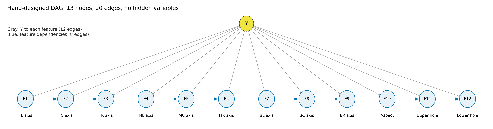
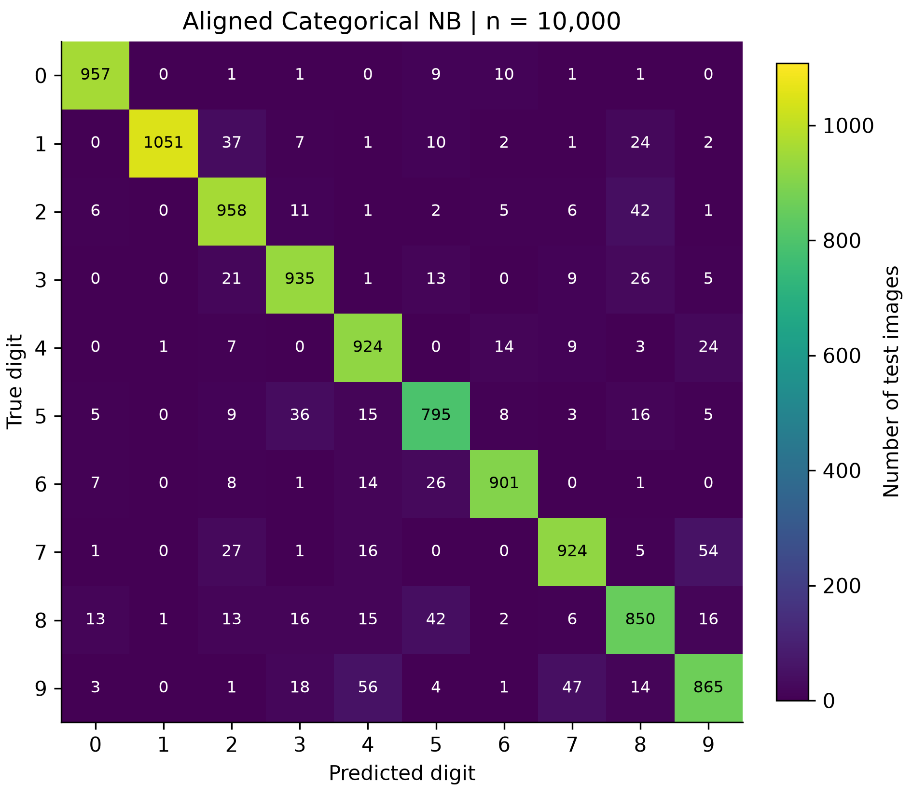
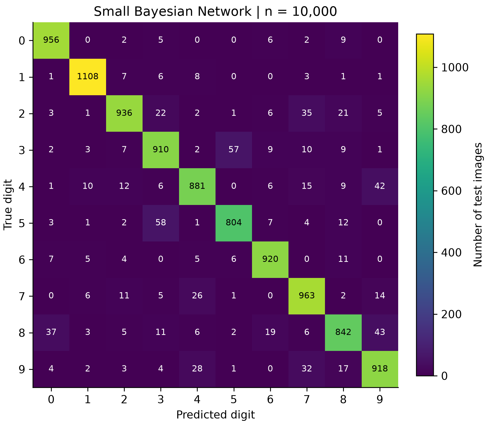
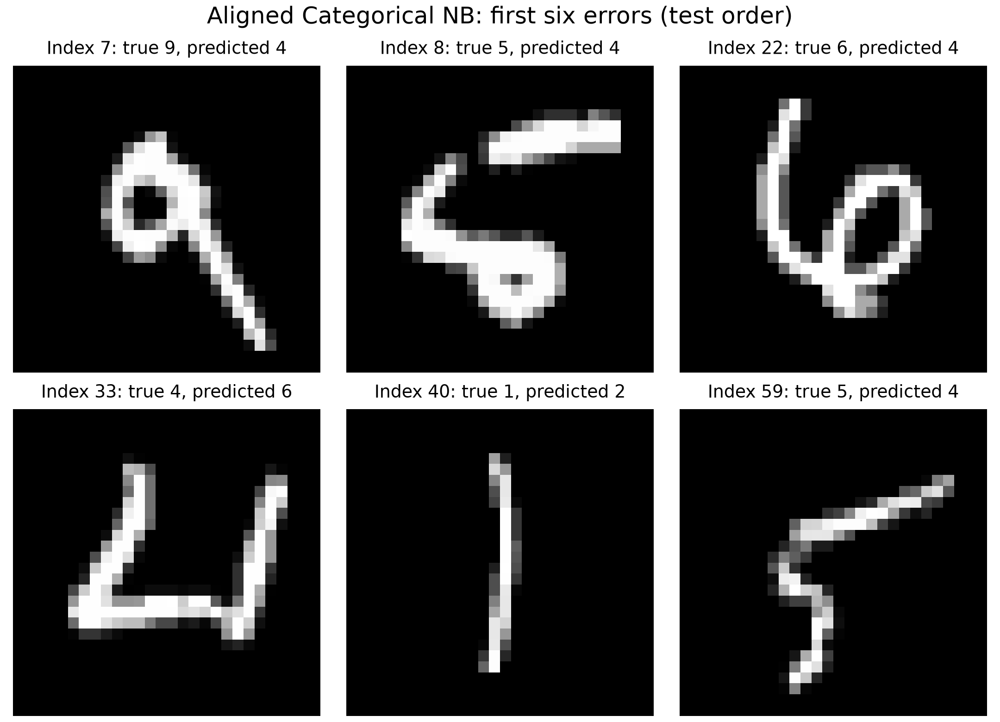
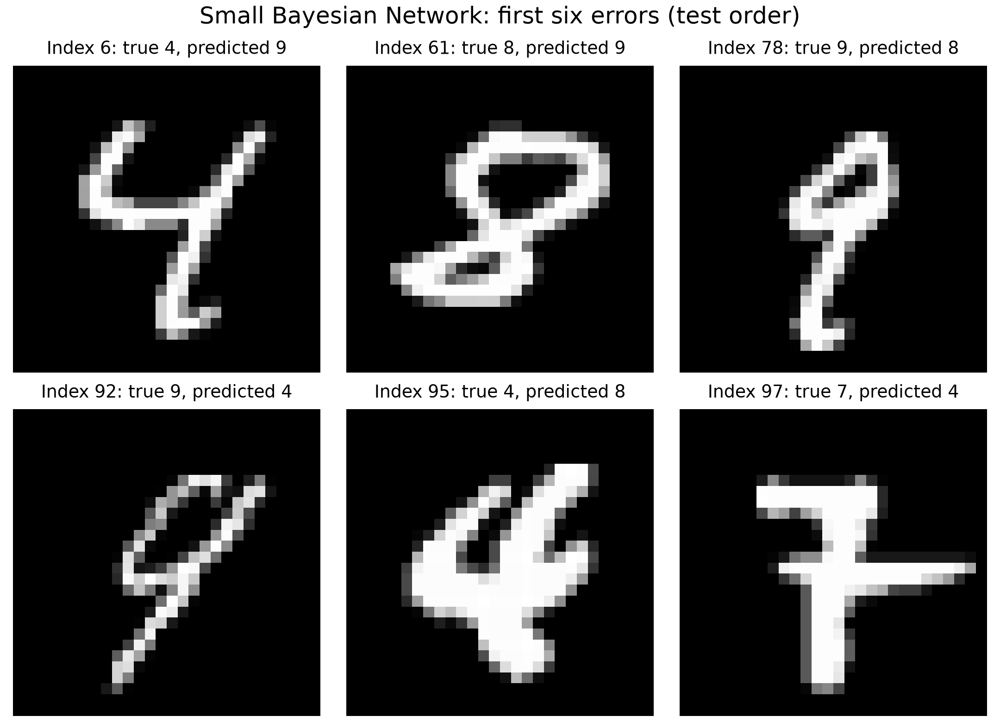

# 手写数字分类实验报告

## 朴素贝叶斯与小型手工贝叶斯网络

本实验在 MNIST 数据集上实现了两个概率分类器。朴素贝叶斯直接使用预处理后的像素，小型贝叶斯网络则把图像概括成十二个离散形状特征，再用手工设计的有向无环图描述其中的部分依赖。两个模型都自行统计先验和条件概率，并在预测时使用对数概率。

实验使用完整的 60,000 张训练图像拟合最终参数，在全部 10,000 张测试图像上评估。朴素贝叶斯的 Accuracy 为 91.60%，Macro F1 为 0.915436；小型贝叶斯网络的 Accuracy 为 92.38%，Macro F1 为 0.922951。两者的差距不大，但得到这些结果的方式有明显区别。前者依靠像素对齐，后者依靠少量有明确含义的特征和条件依赖。

## 一、数据与实验安排

### 1. 数据读取

数据来自课程提供的 `assignment2-data.zip`。每张图像为 28×28 灰度图，像素取值为 0 至 255，标签为数字 0 至 9。读取时保留课程提供的 `mnist_loader.py`，并按照 `manifest.json` 中的 SHA-256 校验四个压缩文件。四项校验均通过，读取后的训练图像没有缺失像素。

| 项目 | 训练集 | 测试集 |
|---|---|---|
| 图像数量 | 60,000 | 10,000 |
| 原始形状 | `(60000,28,28)` | `(10000,28,28)` |
| 传入模型的形状 | `(60000,784)` | `(10000,784)` |
| 图像类型 | `uint8` | `uint8` |

两个分类器都接收原始的 784 维像素。调用者只需要将图像展平，二值阈值、几何变换和特征提取都由模型内部处理。这样，训练入口和课程评测程序可以使用相同接口。

### 2. 验证与测试的分工

选择方案时，从原始训练集每类抽出 1,000 张，组成 10,000 张验证集，其余 50,000 张用于训练候选模型。划分使用固定种子 `20261019`，具体索引保存在实验记录中。候选共 208 组，其中朴素贝叶斯 48 组、小型贝叶斯网络 160 组，包含一些用于核对实现的重复对照。排名首先比较验证集 Macro F1，再比较 Accuracy。

候选比较涉及图像对齐、灰度档数和离散特征，也比较了分箱方式与平滑系数。贝叶斯网络在这些实验中始终使用同一组手工边，没有根据数据搜索结构。选定方案后，正式代码先复现对应的验证结果，再保存配置和源码校验值，最后用完整训练集重新拟合并评估测试集。

早期实现已经查看过这个公开测试集的结果，因此后续比较不能当作一次完全未接触过的独立测试。本轮候选排序只读取训练文件，最终测试结果没有被用来继续调整配置。对单个验证划分比较较多方案，也可能使验证分数偏乐观，结果的适用范围应据此理解。

## 二、朴素贝叶斯的实现

### 1. 先把像素放到可比较的位置

直接比较固定坐标上的像素，会受到书写倾斜和墨迹位置的影响。最终方案先做逐图去倾斜，再统一包围框尺寸，并把灰度质心移到画布中央。这些变换只使用当前图像本身，不使用标签或同批图像的统计量。

去倾斜使用灰度质量中心 $(c_x,c_y)$ 和二阶中心矩。

$$
\mu_{11}=\sum_{x,y} I(x,y)(x-c_x)(y-c_y),\qquad
\mu_{02}=\sum_{x,y} I(x,y)(y-c_y)^2.
$$

令 $k=\mathrm{clip}(\mu_{11}/\mu_{02},-1,1)$。当垂直方差接近零时取 $k=0$。输出位置 $(x,y)$ 从原图的 $x+k(y-c_y)$ 处做水平方向线性采样，图像范围外补零。

去倾斜后，以 `pixel > 64` 确定前景的最小包围框，将框内图像用双线性插值拉伸为 24×24，放入 28×28 画布。随后重新计算灰度质心，用双线性平移将其对齐到 `(13.5,13.5)`。没有前景时输出全零图像。这里没有保留原始宽高比，也没有额外模糊图像，这两个选择在误差分析中都需要留意。

### 2. 条件独立假设与参数估计

对齐后的每个像素划分成八个灰度状态。

$$
Q_i=\min\left(7,\left\lfloor\frac{x'_i}{32}\right\rfloor\right),
\qquad Q_i\in\{0,1,\ldots,7\}.
$$

这些区间依次为 `[0,32)`、`[32,64)`，直到 `[224,256)`。保留多个灰度档，可以利用笔画边缘的强度变化。模型近似认为，在数字类别给定后，784 个离散像素变量条件独立。

$$
P(Y=c\mid Q)\propto P(Y=c)\prod_{i=1}^{784}P(Q_i\mid Y=c).
$$

记训练样本总数为 $N$，类别 $c$ 的样本数为 $N_c$，该类别中像素 $i$ 处于状态 $v$ 的次数为 $N_{civ}$。采用加性平滑估计概率。

$$
\pi_c=\frac{N_c+\alpha}{N+10\alpha},\qquad
\theta_{civ}=\frac{N_{civ}+\alpha}{N_c+8\alpha}.
$$

每个像素的八个状态都增加 $\alpha$ 个伪计数，因此一个灰度状态即使没有在某类中出现，也会得到正概率。每个位置的八项条件概率之和为 1，十个类别的先验也经过平滑。

预测时不直接连乘 784 个概率，而是累加对数。

$$
s_c=\log\pi_c+\sum_{i=1}^{784}\log\theta_{ciQ_i},
\qquad \hat y=\arg\max_c s_c.
$$

灰度状态 0 的背景同样计入分数。可选的 `predict_proba` 先减去每行最大分数，再取指数并归一化。几何对齐让像素更容易比较，真实笔画之间的依赖仍然存在，条件独立只是模型使用的近似。

## 三、小型手工贝叶斯网络的实现

### 1. 用十二个变量概括字形

贝叶斯网络采用九个区域的梯度主方向、一个包围框宽高比，以及上下两个孔洞面积比例。每个特征都划分成五个状态，最终图中只有类别节点 Y 和十二个特征节点。

图像先做与朴素贝叶斯相同的逐图矩去倾斜，再以 `>64` 的前景确定包围框。方向特征使用框内图像的 24×24 双线性采样结果，划成九个 8×8 区域。这个分支不做朴素贝叶斯中的画布质心平移。

在归一化灰度图上，用中心差分计算水平和垂直梯度 $g_x,g_y$，对应方向的外边界导数置零。梯度幅度和无向角为

$$
m=\sqrt{g_x^2+g_y^2},\qquad
\theta=\operatorname{atan2}(g_y,g_x)\bmod\pi.
$$

每个像素的幅度按角度线性分给相邻两个方向档，四个档的中心为 $0,\pi/4,\pi/2,3\pi/4$，首尾循环相邻。区域内求和得到四项幅度 $H_j$，再用二倍角圆周均值压缩成一个主轴方向。

$$
C=\sum_{j=0}^{3}H_j\cos(2\theta_j),\qquad
S=\sum_{j=0}^{3}H_j\sin(2\theta_j),\qquad
u=\frac{\operatorname{atan2}(S,C)\bmod2\pi}{2\pi}.
$$

$u$ 是无向主轴角除以 $\pi$ 后的值，范围为 `[0,1)`；零梯度区域约定为 0。它描述灰度变化的方向，通常与局部笔画走向垂直。四档直方图是计算中间量，每个区域最终只产生一个特征。

宽高比直接取去倾斜前景框的宽度除以高度，无前景时定义为 0。孔洞则在去倾斜的原始 28×28 阈值图上计算。程序从图像四边对背景做四邻域洪泛填充，无法到达边界的背景定义为孔洞。随后按照同一前景框，用最近邻映射采样到 21×21 掩码，上 10 行的孔洞面积除以 210，下 11 行除以 231。

方向图的 24×24 与孔洞掩码的 21×21 是两个明确区分的采样过程。前者提供局部走向，后者提供封闭区域分布，宽高比则保留拉伸时丢掉的一部分比例信息。

| 节点 | 特征语义 | Y 指向该节点的含义 |
|---|---|---|
| F1 | 上左区域梯度主轴角 | 类别与上左局部方向关联 |
| F2 | 上中区域梯度主轴角 | 类别与上中局部方向关联 |
| F3 | 上右区域梯度主轴角 | 类别与上右局部方向关联 |
| F4 | 中左区域梯度主轴角 | 类别与中左局部方向关联 |
| F5 | 中央区域梯度主轴角 | 类别与中央局部方向关联 |
| F6 | 中右区域梯度主轴角 | 类别与中右局部方向关联 |
| F7 | 下左区域梯度主轴角 | 类别与下左局部方向关联 |
| F8 | 下中区域梯度主轴角 | 类别与下中局部方向关联 |
| F9 | 下右区域梯度主轴角 | 类别与下右局部方向关联 |
| F10 | 去倾斜前景框宽高比 | 类别与字形比例关联 |
| F11 | 上部孔洞面积比例 | 类别与上部封闭区域关联 |
| F12 | 下部孔洞面积比例 | 类别与下部封闭区域关联 |

三个特征组分别采用以下四个阈值，均输出 0 至 4 共五个状态，等于阈值时归入较高档。

| 特征组 | 四个阈值 | 区间含义 |
|---|---|---|
| F1 至 F9 | `0.20,0.40,0.60,0.80` | 对应无向角的五档，每档 36° |
| F10 | `0.45,0.60,0.75,0.90` | 字形从窄到宽的五档 |
| F11、F12 | `0.001,0.03,0.10,0.22` | 封闭背景面积从少到多的五档 |

分箱在正式模型中固定，`extract_features(X)` 不依赖标签、当前批次统计量或已拟合对象。

### 2. 手工设计 DAG



图1共有十三个节点和二十条边。Y 为根节点，指向全部十二个特征。特征之间额外保留四组链，分别为 `F1→F2→F3`、`F4→F5→F6`、`F7→F8→F9` 和 `F10→F11→F12`。

| 特征边 | 设计依据 |
|---|---|
| F1→F2 | 上部笔画跨越左右相邻区域时，局部方向可能连续 |
| F2→F3 | 上中到上右的弧线或转折会同时影响两个区域 |
| F4→F5 | 中左与中央的笔画走向可能关联 |
| F5→F6 | 中央到中右的横笔、弧线或转折可能关联 |
| F7→F8 | 下部笔画从左向中延伸时可能具有连续方向 |
| F8→F9 | 下中与下右的弧线和收笔可能关联 |
| F10→F11 | 字形比例可能与上部封闭区域的相对面积关联 |
| F11→F12 | 上下孔洞面积可能共同反映封闭区域的数量和分布 |

这些箭头表示联合分布的统计分解，不作因果解释。每个节点最多有 Y 加一个特征父节点，父节点总数不超过 2。特征父节点的编号总小于子节点，因此不会形成环。整个图没有隐藏变量，结构也没有经过自动学习。

### 3. CPT 学习与预测

对于某个节点的完整父配置 $p$，记其样本数为 $N_p$，其中子状态为 $v$ 的次数为 $N_{p,v}$。每行条件概率按五个子状态平滑并归一化。

$$
P(F_i=v\mid Pa_i=p)=\frac{N_{p,v}+\alpha}{N_p+5\alpha}.
$$

这里的分母必须对应当前父配置。只有类别父节点时，CPT 的形状为 `(10,5)`；再加一个特征父节点时，形状为 `(10,5,5)`。最后一维始终是子状态。未出现的父配置得到五项均为 $1/5$ 的均匀分布。

Y 的先验使用与朴素贝叶斯相同的平滑公式。预测时所有特征已经观测，只需枚举十个候选类别，比较对数联合概率。

$$
\hat y=\arg\max_c\left[\log P(Y=c)+\sum_{i=1}^{12}\log P(F_i=f_i\mid Pa_i)\right].
$$

这一步无需近似推理。如果删去特征间的八条边，模型会退化为同样十二个离散特征上的朴素贝叶斯。后面的消融实验利用了这一关系。

## 四、实验结果与误差分析

### 1. 预处理和特征选择的效果

早期像素模型采用阈值 128 的 Bernoulli 朴素贝叶斯，贝叶斯网络采用区域密度、宽高比和镜像差异。它们在完整测试集上的准确率分别为 84.33% 和 55.91%。这组结果说明，小型网络能表达依赖，也会受到输入特征信息量的限制。后续实验因此同时检查图像对齐和特征表达。

| 实现阶段 | 朴素贝叶斯 Accuracy | 小型贝叶斯网络 Accuracy |
|---|---|---|
| 初始像素与粗区域基线 | 84.33% | 55.91% |
| 去倾斜像素与区域密度、孔洞方案 | 87.75% | 85.16% |
| 最终几何对齐与区域主方向方案 | 91.60% | 92.38% |

三组测试结果都使用完整训练集和测试集，但它们同时改变了多个环节。为了更具体地观察改动，验证集还保留了如下配对结果。表内均使用相同的 50,000 张训练子集和 10,000 张验证图像，$\alpha=0.1$。

| 验证方案 | Accuracy | Macro F1 |
|---|---|---|
| NB，20×20 包围框，无质心对齐 | 0.887700 | 0.887921 |
| NB，20×20 包围框，有质心对齐 | 0.910200 | 0.910359 |
| NB，最终 24×24 包围框与质心对齐 | 0.910400 | 0.910569 |
| BN，去倾斜后的区域密度、宽高比和孔洞 | 0.874200 | 0.873528 |
| BN，未去倾斜的区域主方向、宽高比和孔洞 | 0.874600 | 0.874512 |
| BN，最终去倾斜区域主方向、宽高比和孔洞 | 0.920900 | 0.920849 |
| BN，相同特征改用训练分位数分箱 | 0.913300 | 0.913160 |

对朴素贝叶斯，20×20 的配对实验中，质心对齐带来 2.25 个准确率百分点的提升，说明墨迹中心的位置确实影响了像素比较。对贝叶斯网络，在几何处理和后三个全局特征相同的情况下，用区域主方向替换密度，并采用相应固定分箱后，验证准确率由 87.42% 提高到 92.09%。

另一个对照固定了最终十二个特征和相同平滑系数，只删除特征间的边。无边模型的验证 Accuracy 为 0.904900，Macro F1 为 0.904808；保留手工边时分别为 0.920900 和 0.920849。这个配置中，八条边带来约 1.60 个准确率百分点的提升。无边模型仅用于消融分析，最终贝叶斯网络仍保留八条特征间边。

### 2. 完整测试集结果

最终两个模型都使用 $\alpha=0.1$。类的构造函数仍严格默认 `alpha=1.0`，训练入口显式传入验证选中的值。实验记录的环境为 Python 3.12.14、NumPy 2.3.5 和 Matplotlib 3.11.2。

| 模型 | Accuracy | Macro Precision | Macro Recall | Macro F1 | 正确数 | 错误数 |
|---|---|---|---|---|---|---|
| 朴素贝叶斯 | 0.916000 | 0.915723 | 0.915806 | 0.915436 | 9160 | 840 |
| 小型贝叶斯网络 | 0.923800 | 0.923323 | 0.922958 | 0.922951 | 9238 | 762 |

Precision、Recall 和 F1 先逐类计算，再对全部十类取算术平均。Macro F1 是逐类 F1 的均值，零分母时对应项取 0。由逐样本预测独立重算后，四项指标和混淆矩阵均与保存结果一致。

最终贝叶斯网络比朴素贝叶斯多识别正确 78 张图像，准确率高 0.78 个百分点。由于两个模型的输入表示不同，这个结果不能单独说明哪一种概率结构普遍更优。同特征的有边、无边实验更适合讨论依赖边的贡献。

### 3. 混淆矩阵和各类召回率





图2和图3的行表示真实类别，列表示预测类别，均按 0 至 9 排列。两张图使用同一计数色阶，格内数字是对应样本数。

| 数字 | 测试样本数 | 朴素贝叶斯 Recall | 贝叶斯网络 Recall |
|---|---|---|---|
| 0 | 980 | 0.976531 | 0.975510 |
| 1 | 1135 | 0.925991 | 0.976211 |
| 2 | 1032 | 0.928295 | 0.906977 |
| 3 | 1010 | 0.925743 | 0.900990 |
| 4 | 982 | 0.940937 | 0.897149 |
| 5 | 892 | 0.891256 | 0.901345 |
| 6 | 958 | 0.940501 | 0.960334 |
| 7 | 1028 | 0.898833 | 0.936770 |
| 8 | 974 | 0.872690 | 0.864476 |
| 9 | 1009 | 0.857284 | 0.909812 |

总体准确率提高后，仍然有类别出现退步。朴素贝叶斯对数字 1 的 Recall 从上一方案的 0.969163 降到 0.925991。窄字形在横向拉伸后可能放大小幅度变化，这一点与后面的错误样例相符，但还需要更细的对照才能确认其影响。

### 4. 易混淆数字对

将同一数字对两个方向的错误合并，得到以下前五组。

| 模型 | 数字对 a、b | a→b | b→a | 合计 |
|---|---|---|---|---|
| 朴素贝叶斯 | 7、9 | 54 | 47 | 101 |
| 朴素贝叶斯 | 4、9 | 24 | 56 | 80 |
| 朴素贝叶斯 | 5、8 | 16 | 42 | 58 |
| 朴素贝叶斯 | 2、8 | 42 | 13 | 55 |
| 朴素贝叶斯 | 3、5 | 13 | 36 | 49 |
| 小型贝叶斯网络 | 3、5 | 57 | 58 | 115 |
| 小型贝叶斯网络 | 4、9 | 42 | 28 | 70 |
| 小型贝叶斯网络 | 8、9 | 43 | 17 | 60 |
| 小型贝叶斯网络 | 0、8 | 9 | 37 | 46 |
| 小型贝叶斯网络 | 2、7 | 35 | 11 | 46 |

朴素贝叶斯最常混淆 7 和 9，共 101 次，其中 7 被判成 9 有 54 次。两种写法可能具有相近的斜笔和上部墨迹，像素独立模型难以直接表达弧线是否闭合。贝叶斯网络最常混淆 3 和 5，两个方向分别为 57 次和 58 次，错误较为对称。两者的局部走向会随书写方式接近，而十二个离散摘要仍会丢掉部分连接细节。

### 5. 误分类样例

下面各取原始测试顺序中的前六个错误，共十二张，索引从零开始。图中展示原始灰度输入，标题注明真实标签和预测标签。固定选取规则方便复核，但这些样例不能代表全部错误的频率分布。



朴素贝叶斯把索引 7 的 9 判成 4，也把索引 8 和 59 的 5 判成 4。索引 22 的 6 带有较长的竖笔和明显弧线，同样被判成 4。像素模型没有显式的孔洞和连接变量，局部相似部分可能累积成较大的类别分数。索引 40 的 1 很窄，被判成 2，提示包围框拉伸对部分细长字形并不友好。



贝叶斯网络把索引 6 的 4 判成 9，又把索引 92 的 9 判成 4。索引 61 的 8 上部环大、下部环小，被判成 9；索引 78 的 9 则被判成 8。孔洞比例补充了封闭结构信息，仍不能完整保留环和收笔的形状。索引 97 的 7 带有横穿笔画，被判成 4，也反映出区域主方向对完整连接关系的表达有限。

这些原因是结合图像和特征定义作出的解释，尚未对单张图像做逐特征消融。所有标签与预测均保存在 `results/predictions.csv`，可以按索引复查。

## 五、讨论与反思

这次实验中，一个直接的经验是把概率实现和输入表达分开检查。CPT 每行和为 1，还要继续核对这一行是否真的使用了对应父配置的计数；像素似然也要确认背景状态完整参与了计算。模型公式正确之后，图像对齐和有区分力的特征仍会显著影响结果。

实现检查覆盖了手算像素似然和 CPT，也检查了空图、插值边界和灰度质心。方向特征用已知斜坡验证，孔洞用闭环与开环验证。加上概率归一化、DAG 和接口独立加载，共 23 项检查通过。这些检查能帮助定位实现错误，不能代替对模型假设和数据划分的分析。

朴素贝叶斯的局限主要在像素相关性和几何变换。连续笔画会同时影响多个相邻像素，独立近似可能重复利用同一部分证据；统一拉伸也会改变字形比例。贝叶斯网络保留了一些依赖，但一个区域最终只有一个主方向，方向分布接近均匀时会不稳定，五档量化还会对分界附近的变化敏感。孔洞同样会受到阈值、断笔和去倾斜插值的影响。

如果继续改进，优先做训练集内部多个固定划分的稳定性检查，再核对各特征的分箱占用率。对数字 1 等退步类别，可以单独检查几何归一化的影响；对 3 和 5 的混淆，可以人工提出少量连接或方向特征进行对照。后续贝叶斯网络仍应控制在 6 至 12 个离散特征内，每项 2 至 5 个状态，并保持手工结构和父节点数量限制。

## 六、复现与资料来源

在 `assignment2/` 中安装依赖后运行以下命令。课程原始数据放在平级的 `assignment2-data/mnist/`，不提交到仓库。

```console
python -m pip install -r requirements.txt
python main.py --data-dir ../assignment2-data/mnist
python verify_results.py
```

两个模型文件分别提供 `NaiveBayesClassifier`、`BayesNetClassifier`，都实现规定的 `fit` 和 `predict` 接口，`fit` 返回 `self`。`bayes_net.py` 还提供可复用的 `extract_features(X)`，返回 `(n_samples,12)` 的整数矩阵。

完整候选记录、逐样本预测和代码校验值作为复核附件保留。报告中的方法、结果和误差分析已经集中在本文，阅读正文不需要再打开历史报告。历史材料仍放在 `history/` 中，以便核对实现过程。

1. 课程作业说明 Handwritten Digits Classification（Assignment 2），2026 年 10 月 12 日发布，规定模型协议、实现限制和评估要求。
2. 课程数据包中的 `README.md`、`mnist/manifest.json` 和原样保留的 `mnist_loader.py`。数据来源按课程清单记录为 [Google CVDF MNIST 镜像](https://storage.googleapis.com/cvdf-datasets/mnist/)，实验直接读取课程附带文件。

代码实现和报告整理使用了 Codex 辅助，核心概率估计与预测由 NumPy 编写。实验数值来自实际运行，原始预测和各阶段记录一并保留，供作者复现与核对。
